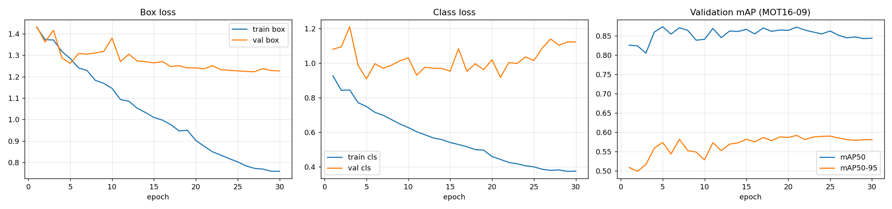
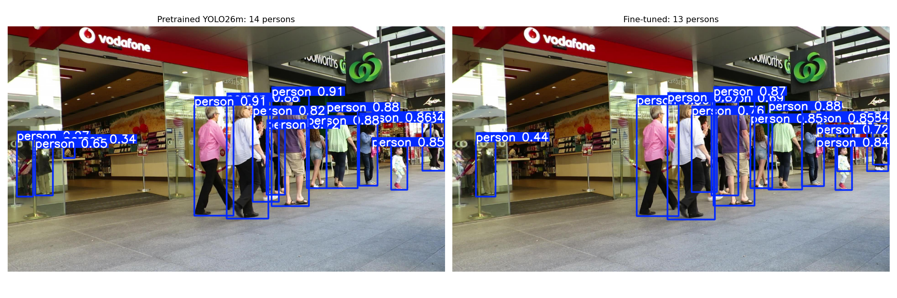

# Modern Multi-Pedestrian Tracking on MOT16

**CS 5567 Deep Learning · University of Missouri**
Team: Tony Nguyen · Rehan Ali · Bosia N'dri

Multi-object tracking (MOT) follows every pedestrian in a video and keeps one persistent ID per person, even through occlusion. This project modernises a 2017-era baseline (Mask R-CNN + Siamese ReID + Hungarian matching) with a current detector and motion-aware trackers. We measure every change with the official MOTChallenge metrics.

> **Status (midterm):** detector fine-tuning is complete. Tracking, ReID and the full ablation are in progress. All numbers below were computed by us; nothing is quoted from the reference project.

---

## Pipeline

```
Video -> Detector (YOLO26) -> Tracker (ByteTrack / BoT-SORT: Kalman + camera-motion compensation)
                                   \-> ReID embeddings (OSNet) ----^
      -> MOT-format txt -> TrackEval (HOTA, MOTA, IDF1, IDsw) -> annotated MP4
```

## Why modernise the baseline

| Baseline gap | Our change |
|---|---|
| Two-stage Mask R-CNN, slow, downscaled input | YOLO26 fine-tuned at 960 px |
| DeepSORT-style matching, no motion model | ByteTrack / BoT-SORT (Kalman, CMC, low-score second association) |
| No MOTA / IDF1 / HOTA reported | Evaluation with TrackEval |
| Evaluated on a single sequence | All 7 labeled train sequences, reported per sequence |
| ReID trained on Market-1501 only | OSNet (pretrained), optional MOT16 fine-tune |

## Results so far

Detector, person class, held-out sequence **MOT16-09** (train/val split is by sequence to avoid frame leakage). GPU: NVIDIA A100 40 GB.

| Model | Precision | Recall | mAP@50 | mAP@50-95 |
|---|---|---|---|---|
| YOLO26m pretrained (COCO) | 0.904 | 0.728 | 0.792 | 0.511 |
| YOLO26m fine-tuned on MOT16 | 0.905 | 0.780 | 0.872 | 0.591 |

Source: [`results/detector_pretrained_vs_finetuned.csv`](results/detector_pretrained_vs_finetuned.csv). Training curves: [`results/detector_training_curves.png`](results/detector_training_curves.png), log: [`results/results.csv`](results/results.csv).

**Training setup** ([`results/detector_training_config.json`](results/detector_training_config.json)): YOLO26m, 30 epochs, 960 px, batch 8, seed 42, cosine LR, early-stopping patience 10, NVIDIA A100-SXM4-40GB (about 91 min). Train on MOT16-02/04/05/10/11/13, validate on MOT16-09.



**Caveats:** `best.pt` was selected on MOT16-09, the same sequence we report on, so the fine-tuned numbers are slightly optimistic. Validation class loss rises in later epochs while train loss keeps falling (mild overfitting); validation mAP50 peaks early (about 0.87 around epoch 5) and plateaus.

### Augmentation experiment (parameter change)

One change, everything else fixed: `scale` augmentation 0.5 vs 0.0, 10 epochs each, same seed, evaluated on MOT16-09 ([`results/augmentation_experiment.csv`](results/augmentation_experiment.csv)).

| Run | scale | Precision | Recall | mAP@50 | mAP@50-95 |
|---|---|---|---|---|---|
| exp_scale0.5 | 0.5 | 0.901 | 0.748 | 0.867 | 0.587 |
| exp_scale0.0 | 0.0 | 0.948 | 0.736 | 0.864 | 0.580 |

Removing scale augmentation raised precision but lowered recall, and mAP changed by less than 0.01. This is a single seed, so the mAP difference is within the range we would expect from run-to-run noise and should not be read as a real effect. Multi-seed runs (planned on HellBender) are needed to conclude anything.

### Qualitative comparison

Same MOT16-09 frame, conf 0.25 ([`results/qualitative_pretrained_vs_finetuned.png`](results/qualitative_pretrained_vs_finetuned.png)): pretrained finds 14 persons, fine-tuned finds 13. Both detect the main pedestrians. Counts on one frame say little on their own; the aggregate metrics above are the real comparison.



Planned ablation (tracking metrics to be added as runs complete):

| ID | Detector | Tracker | ReID | Purpose |
|---|---|---|---|---|
| B0 | Mask R-CNN (reference) | Hungarian IoU + cosine | Siamese R50 | Reproduce baseline |
| E1 | YOLO26 fine-tuned | ByteTrack | none | Detector + motion model |
| E2 | YOLO26 fine-tuned | BoT-SORT | none (CMC) | Camera-motion compensation |
| E3 | YOLO26 fine-tuned | BoT-SORT / DeepOCSORT | OSNet | Appearance |
| E4 (stretch) | best of above | + SAM 2 masks | - | MOTS-style output |

## Repository layout

```
configs/     detector, tracker and threshold settings
data/        MOT16 (gitignored, see Setup)
notebooks/   Colab notebooks, run in order 01 -> 06
results/     tables, figures, logs, videos
src/         run_tracking.py, parsing / conversion / evaluation scripts
report/      LaTeX report (US letter, <= 11 pt)
```

| Notebook | Purpose | Owner |
|---|---|---|
| `01_data_setup_and_validation` | Download MOT16, validate ground truth, baseline vs fine-tuned detector | Tony |
| `02_yolo_dataset_preparation` | Convert MOT16 to YOLO format (sequence-level split) | Tony |
| `03_detector_finetuning` | Fine-tune YOLO26, plot curves | Tony |
| `04_tracking_and_evaluation` | Trackers + TrackEval | Bosia |
| `05_reid_appearance_model` | OSNet / triplet-loss ReID | Rehan |
| `06_test_sequence_inference` | Single-target video on a MOT16 test sequence | Bosia |

## Setup

Code runs on **Google Colab** (GPU runtime); HellBender (Mizzou HPC) is used for long benchmark jobs.

1. Open a notebook in Colab and select a GPU runtime (Runtime > Change runtime type).
2. The first cell mounts Drive and downloads MOT16 once into `MyDrive/MOT16_project/`:
   ```python
   from google.colab import drive; drive.mount('/content/drive')
   !pip -q install ultralytics boxmot motmetrics
   !git clone -q https://github.com/JonathonLuiten/TrackEval
   ```
3. MOT16 ([motchallenge.net/data/MOT16](https://motchallenge.net/data/MOT16/)) is about 1.9 GB and is not committed.

Run a tracker on one sequence:

```bash
python src/run_tracking.py --seq data/MOT16/train/MOT16-09 --tracker botsort.yaml
```

## Evaluation protocol

- Metrics: HOTA, MOTA, IDF1, ID switches and FPS via TrackEval on MOT16 train sequences (the test set has no public labels).
- Per-sequence reporting. MOT16-03 and -04 are the crowded cases where ReID and camera-motion compensation should matter most.
- The detector is never evaluated on sequences it was trained on.
- FPS is reported together with the GPU model.

## Model weights

Weights are not stored in this repository (course rule and size). Fine-tuned `best.pt` is on the team Google Drive: *add link here*.

## Team

| Member | Area |
|---|---|
| Tony Nguyen | Data and detection |
| Rehan Ali | ReID and appearance |
| Bosia N'dri | Tracking and evaluation |

Contribution history is tracked in `WORKLOG.md`.

## References

- Ultralytics YOLO: https://docs.ultralytics.com
- BoxMOT (trackers and ReID): https://github.com/mikel-brostrom/boxmot
- TrackEval: https://github.com/JonathonLuiten/TrackEval
- Milan et al., *MOT16: A Benchmark for Multi-Object Tracking*, 2016.
- Zhang et al., *ByteTrack*, ECCV 2022. Aharon et al., *BoT-SORT*, 2022.
- Reference project: Doan, Stever, Alborno, *Object Tracking* (Apr 2026), the baseline we compare against.
